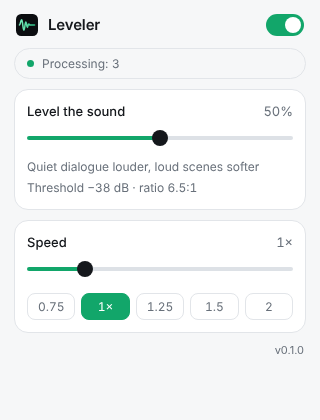

<p align="center"></p>

<h1 align="center">Leveler</h1>

<p align="center"><b>Even out the loudness of any video in your browser</b><br>
English · <a href="README.ru.md">Русский</a></p>

<p align="center">
<a href="LICENSE"></a>
</p>

Leveler is a volume leveler for any HTML5 video or audio: quiet dialogue gets louder, explosions get softer, so you stop reaching for the volume during a movie. It also controls playback speed from 0.25× to 4× without changing the pitch. Everything runs locally in your browser.

> **Status: prototype (step 1).** One compressor chain, a "Level the sound" slider and speed control. Presets, per-site settings, level meters, hotkeys and the website come in the next steps.

<p align="center"></p>

## Install

Not in the stores yet. To try the prototype:

1. Download or clone this repository.
2. Open `chrome://extensions` (Edge: `edge://extensions`, Brave: `brave://extensions`).
3. Turn on **Developer mode** (top right).
4. Click **Load unpacked** and choose the `extension` folder.
5. Pin Leveler on the toolbar, open a page with a video and press play.

Firefox: open `about:debugging#/runtime/this-firefox` → **Load Temporary Add-on…** and choose `manifest.json` from `dist/leveler-firefox-<version>.zip` after unpacking it (see [Build](#build)). In Firefox, allow the extension to access all sites in its permissions, otherwise the content script does not run.

## Features (prototype)

- Web Audio chain for every `<video>` and `<audio>`: high-pass → 3-band EQ → compressor → makeup gain → safety limiter
- One "Level the sound" slider (0–100 %) drives threshold, ratio, knee and attack of the compressor
- On / off switch without reloading the page: a smooth crossfade between the processed and the original sound
- Smooth parameter changes (`setTargetAtTime`), no clicks
- The audio context starts only after a user action on the page, so a video never loses its sound waiting for it
- Videos added later (MutationObserver and a capturing `play` listener), iframes (`all_frames`), fullscreen
- One chain per element (WeakMap), never connected twice
- Playback speed 0.25–4× with `preservesPitch` and a short speed overlay on the video
- DRM and cross-origin media are detected and left untouched, with the message "This site does not support audio processing" in the popup
- Light and dark theme from system settings, English / Русский / Українська

## How the DRM and CORS fallback works

Browsers give Web Audio only silence for DRM-protected media and for media from another origin without CORS. Once an element is connected to Web Audio, this cannot be undone until the page reloads, so Leveler checks before connecting:

- `video.mediaKeys` is set, or the `encrypted` event fired → DRM, not connected;
- the media URL is on another origin and the element has no `crossorigin` attribute → not connected;
- well-known DRM-only sites (Netflix, Disney+, Prime Video, Max, Hulu and others) are never connected.

If silence still comes after connecting (for example, a same-origin URL redirects to another origin), the input analyser sees exact digital zeros for 5 seconds of playback while the browser is decoding audio. Leveler then switches to the dry path, remembers the site in `chrome.storage.local`, and the popup asks to reload the page. After the reload the site plays with the original sound; the popup has a "Try again on this site" button that forgets it.

## Test results

The cloud environment where this prototype was built has no access to YouTube, Twitch or Netflix, so **real sites are not verified yet**. What was checked is listed honestly below.

| Where | Result |
|---|---|
| Local test page, Chrome for Testing 153, headless (`store/tests/run.js`) | ✅ all checks pass, see below |
| YouTube | ⏳ not verified yet |
| Twitch | ⏳ not verified yet |
| Third-party player (Video.js / JW Player on a news site) | ⏳ not verified yet |
| Netflix | ⏳ not verified yet (expected: detected as DRM, original sound, message in popup) |
| Firefox | ⏳ not verified yet (the build script makes the Firefox zip) |

The automated test plays a generated 12-second tone that alternates between −36 dBFS ("dialogue") and −3 dBFS ("explosion") and checks:

- the chain connects only after a click and `play`;
- at 50 % the gap between quiet and loud shrinks from 33 dB to about 11 dB, at 100 % to about 3 dB; loud parts stay well below 0 dBFS;
- switching off sends the original sound through and silences the processed path, switching on brings it back, both without reload;
- a video added to the page later is connected, replaying the same element does not connect it twice, an `<audio>` in an iframe is connected too;
- speed 1.5× is applied in all frames with `preservesPitch`, the speed overlay appears, speed is limited to 4×;
- a cross-origin file without CORS is not connected;
- a same-origin URL that redirects to another origin is detected as silent, the site is remembered, and after reload it is not touched.

Not covered by the automated test: autoplay without any user action (the headless browser allowed the audio context right away), real DRM.

To run it yourself: `npm i playwright`, then `node store/tests/run.js [folder-for-screenshots]`.

## Build

```
python3 tools/build.py
```

Makes `dist/leveler-chrome-<version>.zip` and `dist/leveler-firefox-<version>.zip`. The version comes from `extension/manifest.json`. Before packing, the script checks that the manifest files exist, that all `_locales` have the same keys, and the JS syntax (if `node` is installed).

## Privacy

Leveler collects no data and sends nothing anywhere: the sound is processed on your device. Settings are stored in your browser (`chrome.storage`).

## Repository

| Folder | What is inside |
|---|---|
| [`extension/`](extension) | Extension source (load via `chrome://extensions` → Developer mode → Load unpacked) |
| [`extension/content/`](extension/content) | Content script: audio chain, speed, DRM/CORS detection |
| [`extension/popup/`](extension/popup) | Popup |
| [`extension/shared/`](extension/shared) | Defaults, slider-to-compressor mapping, i18n helper |
| [`docs/`](docs) | Images for the README (the website comes later) |
| [`store/tests/`](store/tests) | Automated test in Chromium |
| [`tools/`](tools) | `build.py` packs the Chrome and Firefox zips |

## License

[MIT](LICENSE) © vkardin
