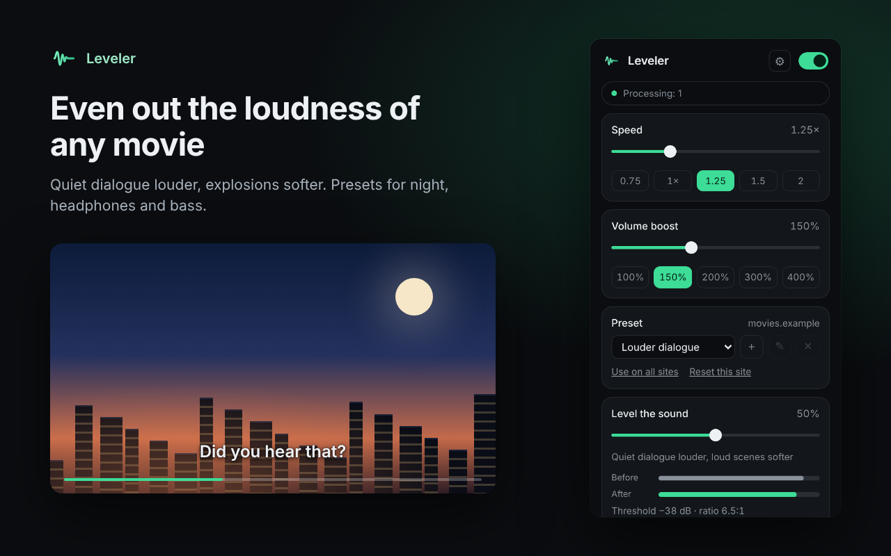
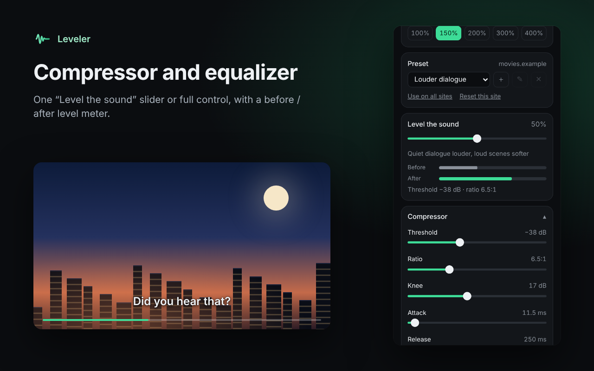
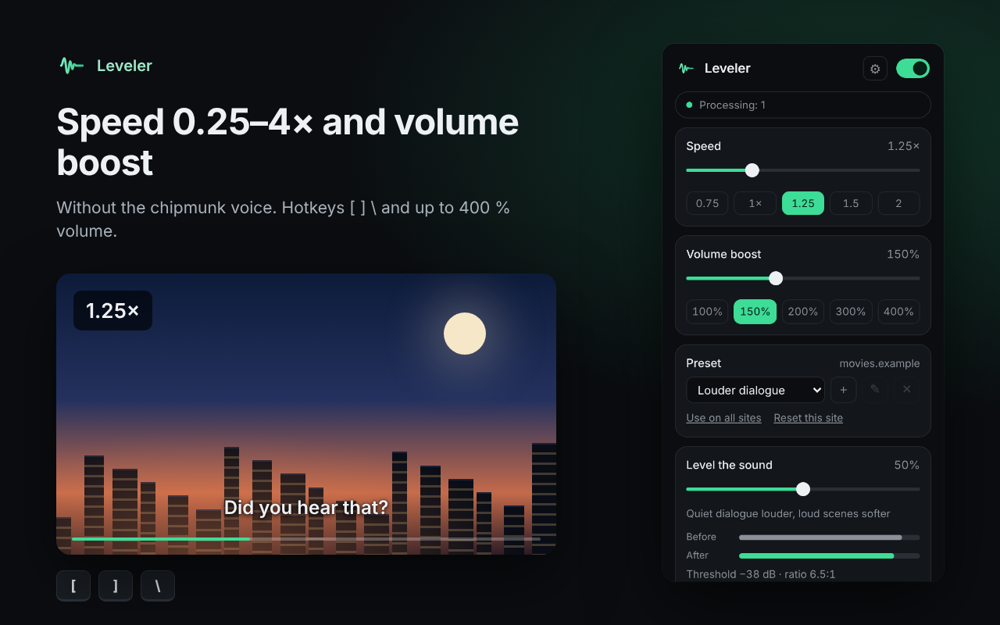

<h1 align="center">Leveler</h1>

<b>Even out the loudness of any video in your browser</b> 
English · <a href="README.ru.md">Русский</a> · <a href="README.uk.md">Українська</a>

Leveler evens out the sound of any HTML5 video or audio: quiet dialogue gets louder, explosions get softer, so you can watch a movie at night without reaching for the volume. It also boosts the volume up to 400 % and changes playback speed from 0.25× to 4× without changing the pitch. Free, no account, everything runs on your device.

## Install

- **Chrome, Edge, Brave, Opera:** [Chrome Web Store](https://chromewebstore.google.com/detail/phbjpipnbhffcegccfbbfabbhmgaelko)
- **Firefox:** Firefox Add-ons (coming soon)
- **Manual install:** download `leveler-chrome-<version>.zip` from [Releases](../../releases), unzip it, open `chrome://extensions`, turn on **Developer mode** and click **Load unpacked** → choose the unzipped folder. Firefox: `about:debugging#/runtime/this-firefox` → **Load Temporary Add-on…** → `manifest.json` from `leveler-firefox-<version>.zip`.

## Features

- Presets: Night mode (strong compression), Louder dialogue, Podcasts, Headphones, Bass+, Music, Off. After install the preset is Off and nothing is processed until you pick one
- One “Level the sound” slider or full control: threshold, ratio, knee, attack, release, makeup gain; low cut and 3-band equalizer
- Volume boost up to 400 % with a safety limiter, level meter before / after compression
- Pan, left/right balance and forced mono, remembered for each site (handy with one earbud or a broken speaker)
- Your own presets: save, rename, delete; preset, volume and speed are remembered for each site
- Playback speed 0.25–4× without the chipmunk voice, hotkeys `[` `]` `\` (configurable), short speed overlay
- Works in iframes and fullscreen, picks up videos added later, starts in open tabs right after install
- Smooth on / off without reloading the page; backup of all settings to a JSON file
- Background tabs (off by default): when sound starts in the tab you are looking at, other tabs with sound pause or get quieter and continue when it stops
- Light and dark theme, English, Русский, Українська

| Presets and level meter | Compressor and equalizer | Speed and volume boost |
|---|---|---|
|  |  |  |

## Sites with DRM

Netflix, Disney+, Prime Video and other services with DRM protection do not let extensions process their sound: the browser gives Web Audio only silence. Leveler detects this before connecting, leaves the sound untouched and shows “This site does not support audio processing”. Speed control still works there.

## Tested

- Automated test in Chromium on a local page: `node store/tests/run.js` (sound chain, presets, per-site settings, hotkeys, backup, DRM/CORS fallback). Runs in GitHub Actions for every pull request and push to `main`
- YouTube in Google Chrome: works (checked by the author after reloading the tab)
- Twitch, other players, Firefox: not verified yet. Please [report](../../issues/new/choose) what you find

## Privacy

Leveler collects no data and sends nothing anywhere: the sound is processed on your device. [Privacy policy](store/PRIVACY.md).

## Feedback and support

- Ideas and bug reports: [GitHub Issues](../../issues/new/choose) or the [support page](https://vkardin.github.io/leveler/support.html)
- Support the project: [vkardin.github.io/leveler/#donate](https://vkardin.github.io/leveler/#donate)

## Repository

| Folder | What is inside |
|---|---|
| [`extension/`](extension) | Extension source (load via `chrome://extensions` → Developer mode → Load unpacked) |
| [`docs/`](docs) | Website, served by GitHub Pages |
| [`store/`](store) | Store texts, screenshots, privacy policy, test and screenshot scripts |
| [`tools/`](tools) | `build.py` packs `leveler-chrome-<version>.zip` and `leveler-firefox-<version>.zip` |
| [`.github/workflows/`](.github/workflows) | `test.yml` runs the build checks and the automated test; `release.yml` publishes a release with both zips when a new version from `manifest.json` reaches `main` (or on demand: Actions → Release → Run workflow) |

## Also by the author

**[Video Glow](https://vkardin.github.io/video-glow/)**: ambient light around any video in the browser, in the colours of the picture, like a TV backlight. Free for Chrome and Firefox. [Website](https://vkardin.github.io/video-glow/) · [GitHub](https://github.com/vkardin/video-glow)

 

**[Snapt](https://vkardin.github.io/snapt/)**: a fast, lightweight, open-source screenshot tool for Windows, macOS and Linux. Select an area, add an arrow or a caption, copy it. No accounts, no cloud. [Website](https://vkardin.github.io/snapt/) · [GitHub](https://github.com/vkardin/snapt)

 

## License

[MIT](LICENSE) © vkardin
