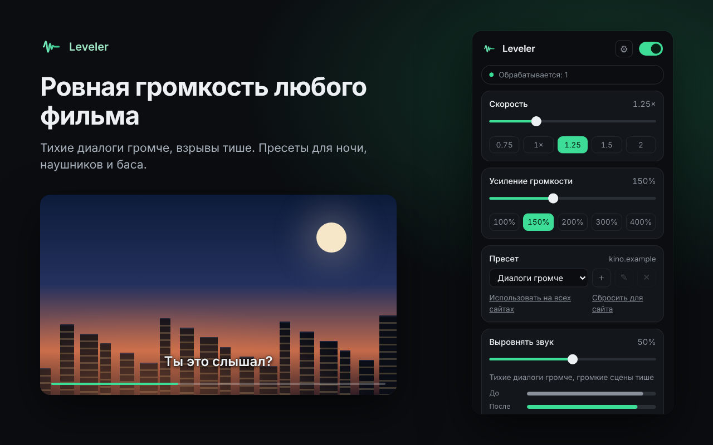
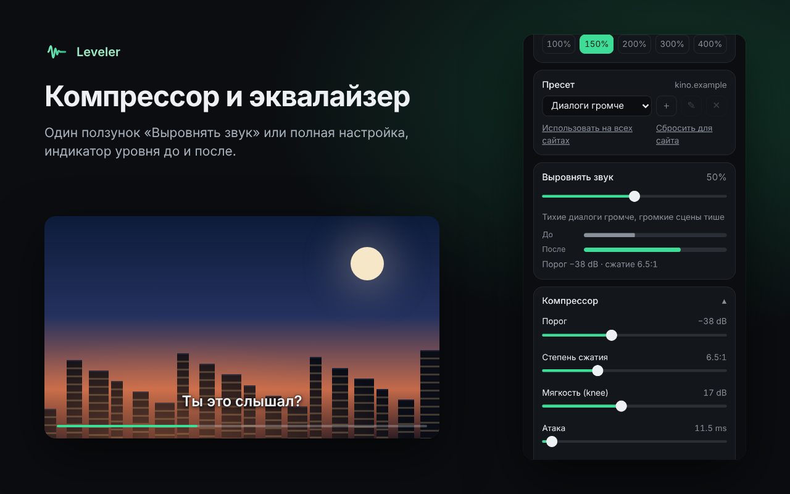
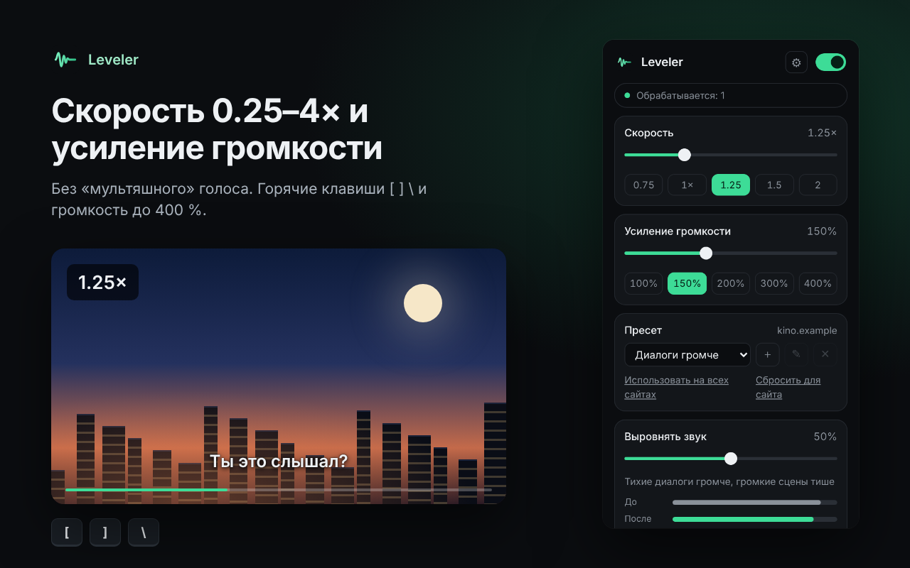

<h1 align="center">Leveler</h1>

<b>Ровная громкость любого видео в браузере</b> 
<a href="README.md">English</a> · Русский · <a href="README.uk.md">Українська</a>

Leveler выравнивает звук любого HTML5-видео и аудио: тихие диалоги громче, взрывы тише, и фильм можно смотреть ночью, не держа руку на регуляторе. Ещё он усиливает громкость до 400 % и меняет скорость от 0.25× до 4× без изменения высоты голоса. Бесплатно, без регистрации, всё работает на вашем устройстве.

## Установка

- **Chrome, Edge, Brave, Opera:** [Chrome Web Store](https://chromewebstore.google.com/detail/phbjpipnbhffcegccfbbfabbhmgaelko)
- **Firefox:** [Firefox Add-ons](https://addons.mozilla.org/firefox/addon/leveler/)
- **Вручную:** скачайте `leveler-chrome-<версия>.zip` на странице [Releases](../../releases), распакуйте, откройте `chrome://extensions`, включите **Режим разработчика** и нажмите **Загрузить распакованное** → выберите распакованную папку. Firefox: `about:debugging#/runtime/this-firefox` → **Загрузить временное дополнение…** → `manifest.json` из `leveler-firefox-<версия>.zip`.

## Возможности

- Пресеты: «Ночной режим» (сильное сжатие), «Диалоги громче», «Подкасты», «Наушники», «Бас+», «Музыка», «Выкл». После установки стоит «Выкл»: звук не обрабатывается, пока вы не выберете пресет
- Один ползунок «Выровнять звук» или полная настройка: порог, степень сжатия, мягкость, атака, восстановление, усиление; срез низов и эквалайзер на 3 полосы
- Усиление громкости до 400 % с защитным лимитером, индикатор уровня до и после компрессии
- Панорама, баланс левого и правого канала и принудительное моно, запоминаются для каждого сайта (пригодится с одним наушником или сломанной колонкой)
- Свои пресеты: сохранить, переименовать, удалить; пресет, громкость и скорость запоминаются для каждого сайта
- Скорость 0.25–4× без «мультяшного» голоса, горячие клавиши `[` `]` `\` (настраиваются), короткий оверлей со скоростью
- Догон прямого эфира (по умолчанию выключен): если трансляция на Twitch, YouTube или Kick отстала, воспроизведение немного ускоряется (до 1.2×), пока запас буфера не станет безопасным, без перескоков и лишних подгрузок
- Работает в iframe и на весь экран, находит видео, которые появились позже, начинает работать в открытых вкладках сразу после установки
- Плавное включение и выключение без перезагрузки страницы; резервная копия всех настроек в JSON
- Фоновые вкладки (по умолчанию выключено): когда звук включается во вкладке, которую вы смотрите, остальные вкладки со звуком ставятся на паузу или звучат тише и продолжают, когда он стихает
- Светлая и тёмная тема, English, Русский, Українська

| Пресеты и индикатор уровня | Компрессор и эквалайзер | Скорость и усиление |
|---|---|---|
|  |  |  |

## Сайты с DRM

Netflix, Кинопоиск, Okko, Иви и другие сервисы с защитой DRM не дают расширениям обрабатывать звук: браузер отдаёт в Web Audio только тишину. Leveler распознаёт это до подключения, не трогает звук и пишет «Этот сайт не поддерживает обработку звука». Скорость там работает.

## Проверено

- Автотест в Chromium на локальной странице: `node store/tests/run.js` (звуковая цепочка, пресеты, настройки сайтов, горячие клавиши, резервная копия, откат для DRM/CORS, фоновые вкладки). Запускается в GitHub Actions для каждого pull request и push в `main`
- YouTube в Google Chrome: работает (проверил автор после перезагрузки вкладки)
- Twitch, другие плееры, Firefox: ещё не проверено. [Напишите](../../issues/new/choose), что получилось

## Конфиденциальность

Leveler не собирает данные и ничего никуда не отправляет: звук обрабатывается на вашем устройстве. [Политика конфиденциальности](store/PRIVACY.md).

## Обратная связь и поддержка

- Идеи и ошибки: [GitHub Issues](../../issues/new/choose) или [страница поддержки](https://vkardin.github.io/leveler/support.html)
- Поддержать проект: [vkardin.github.io/leveler/#donate](https://vkardin.github.io/leveler/#donate)

## Репозиторий

| Папка | Что внутри |
|---|---|
| [`extension/`](extension) | Исходники расширения (загрузка через `chrome://extensions` → Режим разработчика → Загрузить распакованное) |
| [`docs/`](docs) | Сайт для GitHub Pages |
| [`store/`](store) | Тексты для магазинов, скриншоты, политика конфиденциальности, скрипты тестов и скриншотов |
| [`tools/`](tools) | `build.py` собирает `leveler-chrome-<версия>.zip` и `leveler-firefox-<версия>.zip` |
| [`.github/workflows/`](.github/workflows) | `test.yml` запускает проверки сборки и автотест; `release.yml` публикует релиз с обоими zip, когда в `main` приходит новая версия из `manifest.json` (или вручную: Actions → Release → Run workflow) |

## Ещё от автора

**[Video Glow](https://vkardin.github.io/video-glow/)**: подсветка в цвет картинки вокруг любого видео в браузере, как лента за телевизором. Бесплатно для Chrome и Firefox. [Сайт](https://vkardin.github.io/video-glow/) · [GitHub](https://github.com/vkardin/video-glow)

 

**[Snapt](https://vkardin.github.io/snapt/ru/)**: быстрая и лёгкая программа для скриншотов с открытым кодом для Windows, macOS и Linux. Выделите область, добавьте стрелку или подпись и скопируйте. Без аккаунтов и облака. [Сайт](https://vkardin.github.io/snapt/ru/) · [GitHub](https://github.com/vkardin/snapt)

 

**[Floatr](https://vkardin.github.io/floatr/)**: выносит любое веб-видео в плавающее окно поверх всех окон вместе с субтитрами сайта и помнит секунду, где вы остановились. Закладки с заметками и экспорт в Markdown. Бесплатно для Chrome и Firefox. [Сайт](https://vkardin.github.io/floatr/) · [GitHub](https://github.com/vkardin/floatr)

 

**[UNI](https://vkardin.github.io/uni-homebot/)**: ваш домашний сервер в Telegram: приложения одной сеткой, мониторинг, сводка новостей и ремонт сервера в чате и в мини-приложении. Свой экземпляр на своём сервере, ставится одной командой. [Сайт](https://vkardin.github.io/uni-homebot/) · [GitHub](https://github.com/vkardin/uni-homebot)

 

## Лицензия

[MIT](LICENSE) © vkardin
