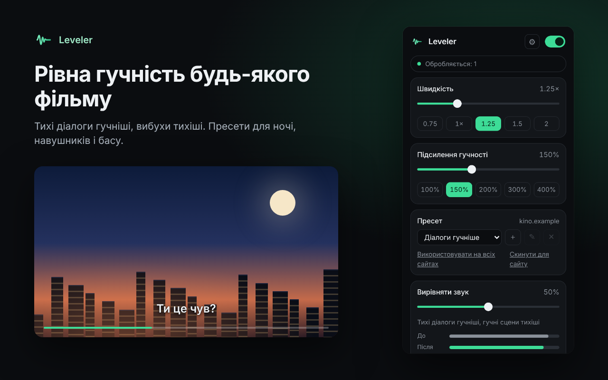
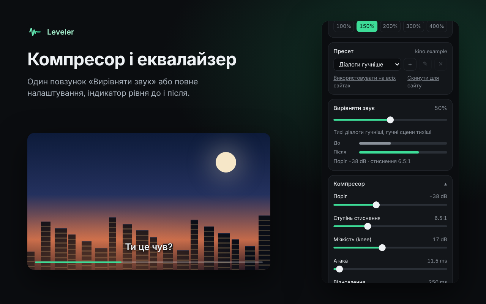
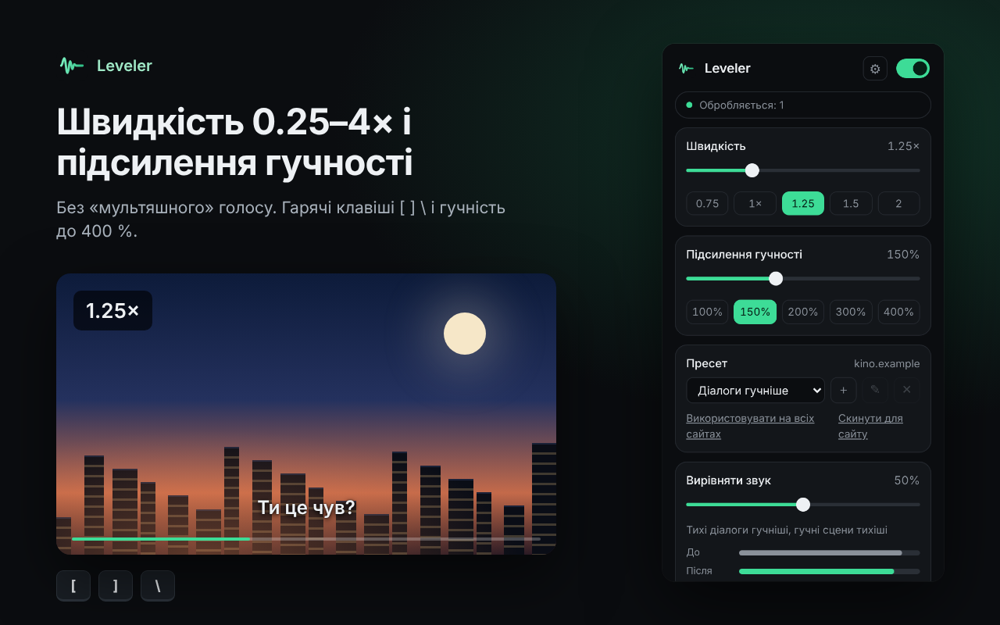

<h1 align="center">Leveler</h1>

<b>Рівна гучність будь-якого відео в браузері</b> 
<a href="README.md">English</a> · <a href="README.ru.md">Русский</a> · Українська

Leveler вирівнює звук будь-якого HTML5-відео та аудіо: тихі діалоги гучніші, вибухи тихіші, і фільм можна дивитися вночі, не тримаючи руку на регуляторі. Ще він підсилює гучність до 400 % і змінює швидкість від 0.25× до 4× без зміни висоти голосу. Безкоштовно, без реєстрації, усе працює на вашому пристрої.

## Встановлення

- **Chrome, Edge, Brave, Opera:** [Chrome Web Store](https://chromewebstore.google.com/detail/phbjpipnbhffcegccfbbfabbhmgaelko)
- **Firefox:** Firefox Add-ons (незабаром)
- **Вручну:** завантажте `leveler-chrome-<версія>.zip` на сторінці [Releases](../../releases), розпакуйте, відкрийте `chrome://extensions`, увімкніть **Режим розробника** і натисніть **Завантажити розпаковане** → виберіть розпаковану папку. Firefox: `about:debugging#/runtime/this-firefox` → **Завантажити тимчасовий додаток…** → `manifest.json` з `leveler-firefox-<версія>.zip`.

## Можливості

- Пресети: «Нічний режим» (сильне стиснення), «Діалоги гучніше», «Навушники», «Бас+», «Вимк». Після встановлення стоїть «Вимк»: звук не обробляється, доки ви не виберете пресет
- Один повзунок «Вирівняти звук» або повне налаштування: поріг, ступінь стиснення, м’якість, атака, відновлення, підсилення; зріз низів і еквалайзер на 3 смуги
- Підсилення гучності до 400 % із захисним лімітером, індикатор рівня до і після компресії
- Власні пресети: зберегти, перейменувати, видалити; пресет, гучність і швидкість запам’ятовуються для кожного сайту
- Швидкість 0.25–4× без «мультяшного» голосу, гарячі клавіші `[` `]` `\` (налаштовуються), короткий оверлей зі швидкістю
- Працює в iframe і на весь екран, знаходить відео, що з’явилися пізніше, починає працювати у відкритих вкладках одразу після встановлення
- Плавне вмикання й вимикання без перезавантаження сторінки; резервна копія всіх налаштувань у JSON
- Світла й темна тема, English, Русский, Українська

| Пресети та індикатор рівня | Компресор і еквалайзер | Швидкість і підсилення |
|---|---|---|
|  |  |  |

## Сайти з DRM

Netflix, Megogo, Sweet.tv та інші сервіси із захистом DRM не дозволяють розширенням обробляти звук: браузер віддає у Web Audio лише тишу. Leveler розпізнає це до підключення, не чіпає звук і пише «Цей сайт не підтримує обробку звуку». Швидкість там працює.

## Перевірено

- Автотест у Chromium на локальній сторінці: `node store/tests/run.js` (звуковий ланцюжок, пресети, налаштування сайтів, гарячі клавіші, резервна копія, відкат для DRM/CORS)
- YouTube у Google Chrome: працює (перевірив автор після перезавантаження вкладки)
- Twitch, інші плеєри, Firefox: ще не перевірено. [Напишіть](../../issues/new/choose), що вийшло

## Конфіденційність

Leveler не збирає дані й нічого нікуди не надсилає: звук обробляється на вашому пристрої. [Політика конфіденційності](store/PRIVACY.md).

## Зворотний зв’язок і підтримка

- Ідеї та помилки: [GitHub Issues](../../issues/new/choose) або [сторінка підтримки](https://vkardin.github.io/leveler/support.html)
- Підтримати проєкт: [vkardin.github.io/leveler/#donate](https://vkardin.github.io/leveler/#donate)

## Репозиторій

| Папка | Що всередині |
|---|---|
| [`extension/`](extension) | Вихідний код розширення (завантаження через `chrome://extensions` → Режим розробника → Завантажити розпаковане) |
| [`docs/`](docs) | Сайт для GitHub Pages |
| [`store/`](store) | Тексти для магазинів, скриншоти, політика конфіденційності, скрипти тестів і скриншотів |
| [`tools/`](tools) | `build.py` збирає `leveler-chrome-<версія>.zip` і `leveler-firefox-<версія>.zip` |

## Ще від автора

**[Video Glow](https://vkardin.github.io/video-glow/)**: підсвітка в колір картинки навколо будь-якого відео в браузері, як стрічка за телевізором. Безкоштовно для Chrome і Firefox. [Сайт](https://vkardin.github.io/video-glow/) · [GitHub](https://github.com/vkardin/video-glow)

 

**[Snapt](https://vkardin.github.io/snapt/uk/)**: швидка й легка програма для скриншотів з відкритим кодом для Windows, macOS і Linux. Виділіть область, додайте стрілку чи підпис і скопіюйте. Без акаунтів і хмари. [Сайт](https://vkardin.github.io/snapt/uk/) · [GitHub](https://github.com/vkardin/snapt)

 

## Ліцензія

[MIT](LICENSE) © vkardin
